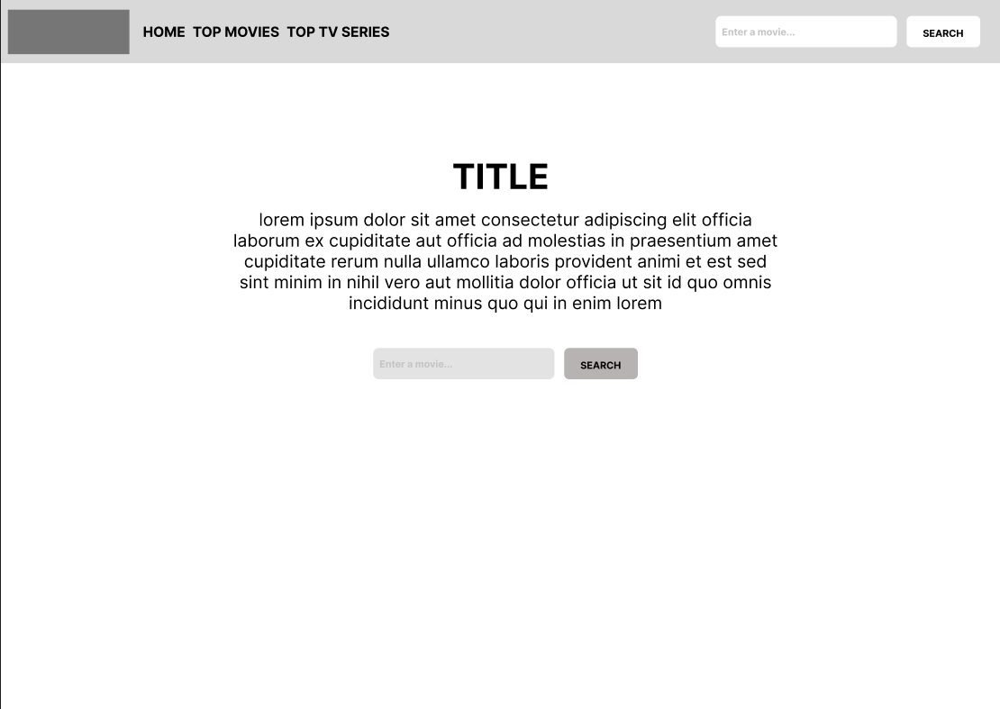
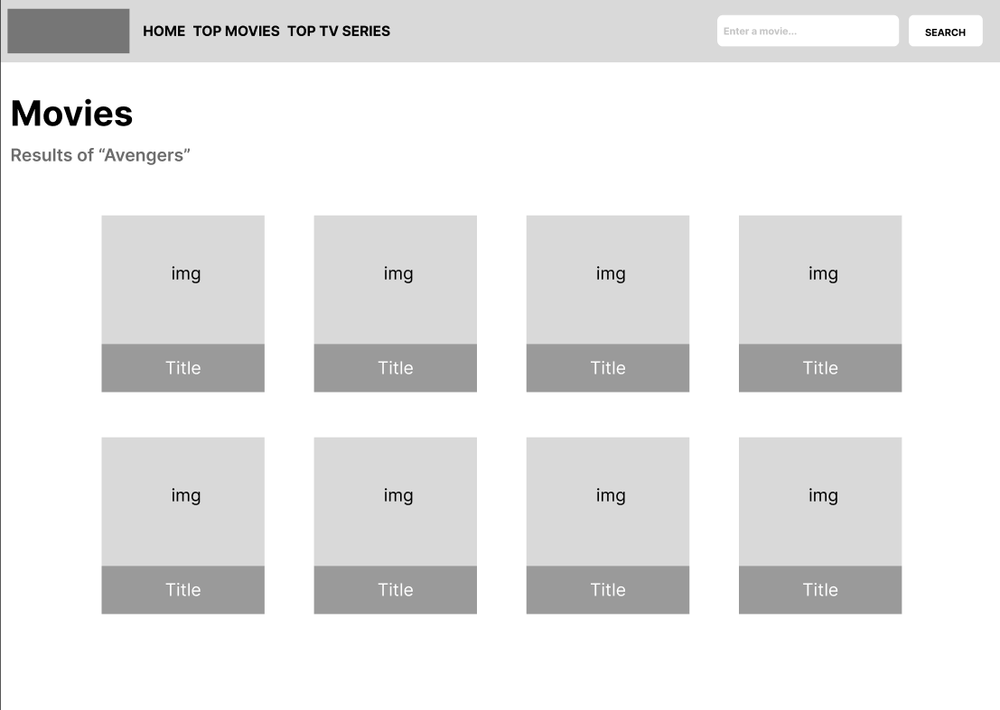
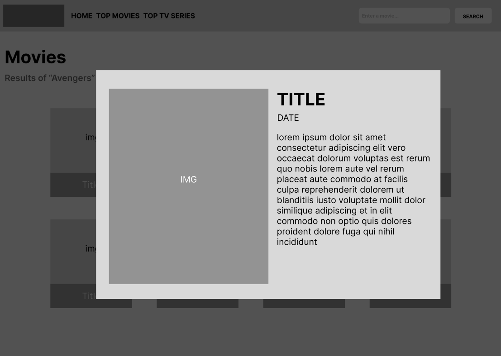

# MOVIE DATABASE

## Which data will I be fetching?
* Movie Title
* Movie Description / Plot summary
* Movie Release Date
* Movie Poster

## My API Endpoints
* "https://api.themoviedb.org/3/movie/${id}" - For getting a movie by using an id
* "https://api.themoviedb.org/3/search/movie?query=${title}" - For getting a results from a movie title input
* "https://api.themoviedb.org/3/${entertainmentType}/top_rated" - For getting either Top Movies or Top TV Series depending on entertainmentType variable

## How will the user interact with my page
* The user will navigate through my website to get specific movies for plot, cover, and release dates
* The website offers two grouped results which are: Top Movies and Top TV Series

## Sketch

